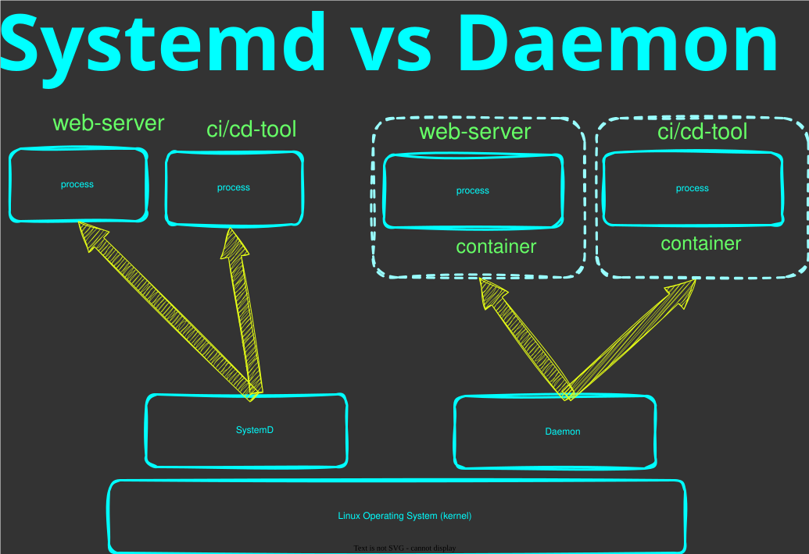
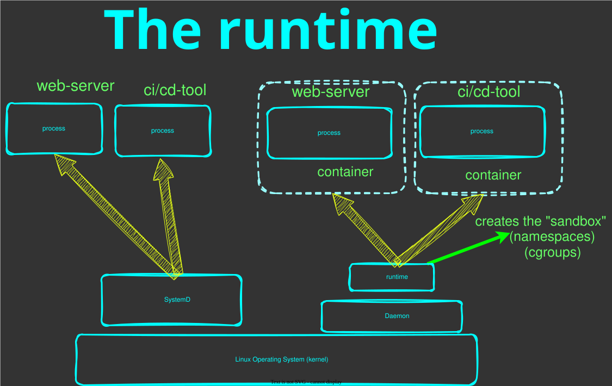

# 🎬 Running and Configuring Containers

## 💡 Preface

This module is part of a course on DevOps. </br>
Check out the [course introduction](../../../README.md) for more information </br>
This module is part of [chapter 6](../../../chapters/chapter-6-docker/README.md)

So far we've learned what containers are. This module takes the next baby step as we learn how to run a container. </br>
There are a lot of fundamentals and principles about containers that we'll learn throughout this Chapter and also many different ways to run a container. </br> 

For example, container technology assumes you know how a process runs on Linux. </br>
It also assumes you understand state. When a process terminates, everything it stored in RAM (memory) is lost. </br>
Everything it stores on the filesystem is kept, assuming the process restarts on the same machine. </br>

A process needs a file system to interact with its own files, and libraries and dependencies </br>
A process needs access to memory, disk, CPU and network. </br>

When running containers, it's important to focus on the process's needs. </br>
If a process looks for a file on disk, that exists on the host server, the container may not see that file as it has its own filesystem. Therefore the process may crash with a "File not found error" </br>

This is why it can be slightly more challenging to run processes in containers, because we need to ensure the process has everything it needs to run at all times. </br>

This module focuses on running containers, their inputs and outputs </br>
We'll slowly be introduced to command line for containers, so new commands and arguments </br>

## The Container Runtime (how containers run)

### The Daemon

Looking back at our chapters on Operating Systems, Web servers and CI/CD, we encountered `systemd`. </br>
`systemd` was responsible for keeping our web server running as well as our CI/CD tool. </br>
You configure `systemd` with the path of an application, its configuration and how to run it. </br>
When the operating system starts, `systemd` starts that application and ensures it stays running. </br>

The Docker daemon (`dockerd`) has the same role, but for containerized processes. </br>
It is a background service that is always running, listening for commands from the CLI. </br>
It manages the full lifecycle of containers, images, networks and volumes. </br>

Where `systemd` managed our web server process directly on the host, the daemon manages our containers. </br>



### The Runtime

The daemon does not create containers itself. </br>
It delegates that work to a lower-level component called the container runtime. </br>
The runtime is what actually talks to the Linux kernel to set up the namespaces, cgroups and filesystem layers we covered in an earlier module. </br>
Users do not interact with the runtime directly. The daemon handles that, but it is worth knowing it exists. </br>

We will learn how to run containers, and when doing so, we'll use the command line. </br>
This re-iterates on our previous mentions about why the command line is so important. </br>

When we run containers using the command line, we tell the daemon, the daemon tells the runtime, and the runtime makes the kernel calls to create the sandbox. </br>



### Popular container runtimes

- [`docker`](https://www.docker.com): the most widely used, and what we use throughout this course. The CLI, daemon and runtime come bundled together in a single install.
- [`containerd`](https://containerd.io): the runtime that runs underneath Docker. When Docker runs a container, it delegates to containerd to do the heavy lifting. Kubernetes uses containerd directly, without Docker.
- [`Podman`](https://podman.io): a daemonless, Docker-compatible alternative. Each container runs as a direct child process rather than going through a background service. Popular in enterprise Linux environments.

Because of containerization standards, all three can run the same container images. The runtime is interchangeable and the skills transfer.

### Installation

In this course, I will be using [Docker](https://docs.docker.com/engine/install/ubuntu/) as my container runtime. </br>
We'll walk through the installation slowly, recapping a few things we've learned in scripting and automation. </br>

In this section we will:

* Start with an [installation script](.test/install-docker.sh) (Automation mindset)
* Add Docker's Linux repository
* Install the Docker daemon and CLI

Check the Docker daemon is running:

```shell
sudo systemctl status docker
```

`systemctl` is the command-line tool for interacting with `systemd`. It lets you start, stop, restart, enable and inspect any service managed by `systemd` on a Linux system. </br>

As you may notice, the Docker daemon is actually managed by `systemd`. </br>
`systemd` ensures the Docker daemon service keeps running. </br>

## Running our first container

Now before we run our container, we'll need to free up port `8080` </br>
Because we've set up our existing Web server from a previous chapter to use that port. </br>
We've also set up port forwarding from our host to our virtual server for that port. </br>

In our server, let's stop our web server:


```shell
sudo systemctl status nginx 
sudo systemctl stop nginx 
```

Then we can run a web server using docker. </br>
For running container images the docker CLI has a `run` subcommand:

```shell
docker run -it -p 80:80 nginx:latest
```

## Process Inputs

In our earlier chapters on Operating Systems, we learned how processes work. A process is simply a running program, and for most programs to do anything useful, they require inputs. 

Because a container is ultimately just a sandboxed process, it has the exact same requirements. A containerized application needs inputs to know how to behave, where to find its configuration, or how to communicate. 

For example, in Chapter 4, our Web server required an `nginx.conf` configuration file to know what port to listen on and how to route traffic. That configuration file was an essential input to the web server process.

The Web server also took network inputs on port `80`. </br>

The most common types of inputs a process needs are:

- `Files`: Applications often need to read configuration files on disk (like an `nginx.conf` for a web server) or require a directory to read/store persistent data.
- `Environment Variables`: Key-value pairs provided to the process at startup. These are often used for dynamic settings, flags, or secrets (like database credentials). We've learned about environment variables during our scripting activities. 
- `Command-Line Arguments`: Parameters passed directly to the application's startup command to modify its default behavior. We've learned about the command line quite extensively throughout this course.
- `Networking`: A network port that the process binds to so it can listen for incoming traffic (for example, a web server listening on port 80).


<b>Important: </b>Because a container runs in an isolated environment, it doesn't automatically have access to the host's files, environment variables, or network. We have to explicitly provide these inputs to the container when we run it.

Throughout this module and upcoming modules we will focus on learning how to provide important inputs for containers. </br>

## Container Inputs

### Files

#### Sharing files with Containers

A container process needs configuration the same way a process on a server does. </br>

In Chapter 4, we gave NGINX a custom `nginx.conf` to tell it what port to listen on and where to find our website files. </br>

We can do the same with a container using what's called a bind mount. </br>
A bind mount allows us to map a local directory or file, into the container's filesystem. </br>

Before we start, let's get our terminal into the directory where I have a copy of our website configuration and files from Chapter 4. </br>
So on our SSH session with our server, let's change directory to [Introduction](../introduction/).

#### Mounting files

Let's break down the following command to run our web server in a container. </br>
This time we expand the command to include a bind mount.

```shell
docker run -it -p 80:80 \
  -v $PWD/nginx.conf:/etc/nginx/nginx.conf \
  -v $PWD/my-website/:/websites/my-website/ \
  nginx:latest
```

<i>Note: if you have restarted your virtual server, you may need to stop the webserver as it may conflict with port `80`. Stop it with `sudo systemctl stop nginx` </i></br>

A bind mount uses the `-v` flag to map a file or directory from the host into the container's filesystem. </br>

The input is separated by a `:` character. The left side of the `:` represents the file on the host server and the right side of the `:` represents the file inside the container. </br>

In this case, `$PWD` is our current working directory in the terminal. </br>
and there needs to be an `nginx.conf` file & `my-website` directory before this can be mounted successfully </br>

If you recall in our Chapter on web servers, we configured our web server using [nginx.conf](../introduction/nginx.conf) </br>
In that configuration file, we tell the web server where our [my-website](../introduction/my-website/) assets are. </br>
These are a copy of the files from Chapter 4. </br>

The container process sees the file at `/etc/nginx/nginx.conf`, but it physically lives on the host. </br>
The web server will read the configuration file and look for website content at `/websites/my-website/`

### Environment Variables

We have learned about environment variables during our scripting chapters. </br>
They are key-value pairs that are available to a process at startup. </br>

To pass an environment variable into a container, we use the `-e` flag. </br>
To demonstrate, we can use a small Linux image called `alpine` to prove the variable lands inside the container. </br>

```shell
docker run --rm -e MY_ENV_VAR=hello alpine printenv MY_ENV_VAR
```

This prints `hello` to the terminal. The container started, printed the variable, and was removed. </br>

Environment variables are commonly used for things like database connection strings, API keys, and feature flags. </br>
The application reads them at startup rather than hardcoding values into the image. </br>

This means the same image can be configured differently across environments. </br>
Development, staging and production can all run the same image with different inputs. </br>

### Commandline Arguments

We've learned in previous chapters how important the command line is when it comes to DevOps. </br>
We've learned about running various applications on the command line and about their different arguments and options. </br>

For example, throughout this course we have used `curl` to fetch things from the internet. </br>
We can run `curl` as a container using the `curlimages/curl` image and pass arguments to it exactly the same way. </br>

```shell
# without containers
curl -v http://google.com

# using containers
docker run --rm curlimages/curl curl -v http://google.com
```

Notice the `-v` flag is the same argument we've used before. </br>
However, everything <b>after</b> the image reference, gets passed to the container </br>

The container starts, runs `curl` with those arguments, and exits. </br>

The arguments are passed directly to the process running inside the container. </br>
From the process's point of view, nothing is different. `curl` process will see the `-v` and the URL the same way. </br>


### Networking inputs

A process that listens on a network port needs that port to be accessible from outside. </br>
In Chapter 4, we set up a port forward on our virtual server so that traffic on port `8080` on our local machine reached port `80` on the server. </br>

Containers work the same way. </br>
A process that is "containerized" and listening on a port can not be reached without explicitly opening that port </br>

The container has its own isolated network namespace with its own port space, and we use `-p` to map a host port to a container port. </br>

Refer to our full command: 

```shell
docker run -it -p 80:80 \
  -v $PWD/nginx.conf:/etc/nginx/nginx.conf \
  -v $PWD/my-website/:/websites/my-website/ \
  nginx:latest
```

The `-p` flag follows the same pattern as `-v`, a `:` separates the two sides. </br>
The left side is the port on the host, the right side is the port inside the container. </br>
Traffic hitting `localhost:80` on the host gets forwarded to port `80` inside the container. </br>

This is the same concept as the port forward we set up on our virtual server in earlier chapters. </br>
Docker handles it automatically at the container level. </br>

The benefit here is that we can run many web servers, and they can all listen on the same port. </br>
This is great for security and consistency. </br>

## Where to from here

So far in this Chapter, we learned what containers are and how to run them. </br>
We've also covered how containers receive inputs like files, environment variables and network requests. 
There's a lot more to running containers than a `docker run` command. You can stop, start, remove and take various other actions with containers </br>
Containers have a full lifecycle similar to a process </br>

This module gave us a hint of the command-line expectations of processes and containers, so in upcoming modules we'll expand on that. </br>


